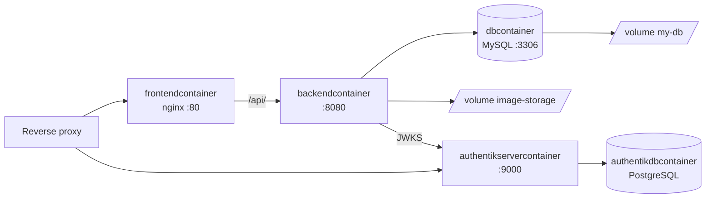

# Deployment

The application is deployed with Docker Compose using `docker-compose.yml` in the repository root. The
[pipeline](../pipeline.md#deployment) does this automatically on every push to `main`.

## Containers

| Service    | Container           | Image / Build                  | Port (host:container) | Description                          |
|------------|---------------------|--------------------------------|-----------------------|--------------------------------------|
| `mysqldb`  | `dbcontainer`       | `mysql:5.7`                    | `3306:3306`           | Database `indexcardsdb`              |
| `backend`  | `backendcontainer`  | `indexcards/Dockerfile`        | `8081:8080`           | Spring Boot backend                  |
| `frontend` | `frontendcontainer` | `indexcards-ui/Dockerfile`     | `4200:80`             | Angular app served by nginx          |
| `authentik-db`     | `authentikdbcontainer`     | `postgres:16-alpine`                  | —           | Database of Authentik                |
| `authentik-server` | `authentikservercontainer` | `ghcr.io/goauthentik/server:2025.10`  | `9000:9000` | Login service (OIDC, Google login)   |
| `authentik-worker` | `authentikworkercontainer` | `ghcr.io/goauthentik/server:2025.10`  | —           | Background tasks, applies blueprints |



- The **frontend** image builds the Angular app with Node and serves it with nginx (`indexcards-ui/nginx.conf`).
  nginx serves the app for all paths (falling back to `index.html` for client-side routing) and forwards `/api/` to
  `backendcontainer:8080`.
- The **backend** image builds the jar with Maven and runs it on Java 21.
- The frontend and backend are also attached to the external network `nginx_backend`, which is used by the reverse
  proxy on the server. It has to exist before starting: `docker network create nginx_backend`.

### Volumes

| Volume          | Mounted at               | Content                          |
|-----------------|--------------------------|----------------------------------|
| `my-db`         | `/var/lib/mysql`         | MySQL data                       |
| `image-storage` | `/app/data/images`       | Uploaded images of index cards   |
| `authentik-db`  | `/var/lib/postgresql/data` | Authentik users, sessions, events |

All volumes must be included in backups.

### Logging

All containers use the `json-file` log driver with at most 3 files of 10 MB each, so logs (including nginx access logs
with IP addresses) are rotated automatically.

## Configuration

The backend is configured in `indexcards/src/main/resources/application.properties`. Values can be overridden with
environment variables.

| Environment variable           | Default                                  | Description                                                   |
|--------------------------------|------------------------------------------|---------------------------------------------------------------|
| `DB_PASSWORD`                  | —                                        | Used by Docker Compose as MySQL root password and for the backend. |
| `SPRING_DATASOURCE_URL`        | `jdbc:mysql://${MYSQL_HOST:localhost}:3306/indexcardsdb` | Database URL.                          |
| `SPRING_DATASOURCE_USERNAME`   | `root`                                   | Database user.                                                |
| `SPRING_DATASOURCE_PASSWORD`   | `12345678`                               | Database password.                                            |
| `MYSQL_HOST`                   | `localhost`                              | Database host (if `SPRING_DATASOURCE_URL` is not set).        |
| `IMAGES_STORAGE_PATH`          | `./data/images`                          | Directory for uploaded images.                                |
| `AUTHENTIK_URL`                | —                                        | Public URL of Authentik, e.g. `https://auth.indexcards.7ubi.de` (no trailing slash). |
| `INDEXCARDS_URL`               | —                                        | Public URL of the app, e.g. `https://indexcards.7ubi.de`; used for the OIDC redirect URI. |
| `AUTHENTIK_SECRET_KEY`         | —                                        | Authentik's secret key (`openssl rand -base64 60 \| tr -d '\n'`). Never change it after the first start. |
| `AUTHENTIK_PG_PASSWORD`        | —                                        | Password of Authentik's PostgreSQL database.                  |
| `AUTHENTIK_BOOTSTRAP_PASSWORD` | —                                        | Password of the Authentik admin `akadmin`, only used on the first start. |
| `AUTHENTIK_BOOTSTRAP_EMAIL`    | —                                        | Email of `akadmin`, only used on the first start.             |
| `GOOGLE_CLIENT_ID`             | —                                        | OAuth client of the Google Cloud project.                     |
| `GOOGLE_CLIENT_SECRET`         | —                                        | Secret of that OAuth client.                                  |
| `AUTHENTIK_ISSUER`             | `http://localhost:9000/application/o/indexcards/` | Backend: expected token issuer (set by Docker Compose from `AUTHENTIK_URL`). |
| `AUTHENTIK_JWKS_URI`           | `http://localhost:9000/application/o/indexcards/jwks/` | Backend: where the token signing keys are fetched. |
| `AUTHENTIK_CLIENT_ID`          | `indexcards`                             | Backend: OIDC client id / expected token audience.            |

Other settings in `application.properties`:

| Property                                   | Value      | Description                        |
|--------------------------------------------|------------|------------------------------------|
| `spring.servlet.multipart.max-file-size`   | `5MB`      | Maximum size of an uploaded image. |

## Login (Authentik)

Users log in through [Authentik](https://goauthentik.io), either with a username and password stored in Authentik
(self-service signup on the login page, no email address) or with their Google account. The two kinds of account are
not linked. The app never sees passwords or email addresses; the backend only validates Authentik's access tokens.

There is no email, so there is no self-service password reset. If a user forgets their password, open
*Directory → Users* in the Authentik admin, select the user and use *Create recovery link*, then send them the link.
Disabling or deleting a user there blocks their login. Authentik is configured by the blueprint
`authentik/blueprints/indexcards.yaml`, which the worker applies on every start.

### One-time setup

1. **Google OAuth client:** In the Google Cloud Console (APIs & Services → Credentials) create an OAuth client ID of
   type *Web application* with the authorized redirect URI `<AUTHENTIK_URL>/source/oauth/callback/google/`. Configure
   the consent screen with the scopes `openid`, `email` and `profile`, and publish it.
2. **Reverse proxy:** Route `AUTHENTIK_URL` (e.g. `auth.indexcards.7ubi.de`) to `authentikservercontainer:9000` on
   the `nginx_backend` network. Pass the `Host` header and `X-Forwarded-Proto: https` through, because Authentik
   builds the token issuer from them and it must equal `<AUTHENTIK_URL>/application/o/indexcards/`.
3. **GitHub:** Create the repository secrets `AUTHENTIK_SECRET_KEY`, `AUTHENTIK_PG_PASSWORD`,
   `AUTHENTIK_BOOTSTRAP_PASSWORD`, `AUTHENTIK_BOOTSTRAP_EMAIL`, `GOOGLE_CLIENT_ID`, `GOOGLE_CLIENT_SECRET` and the
   repository variables `AUTHENTIK_URL`, `INDEXCARDS_URL`. Remove the old `JWT_SECRET` secret.
4. After the first deployment, log in to `<AUTHENTIK_URL>/if/admin/` as `akadmin` and check under
   *Customization → Blueprints* that `indexcards` was applied successfully. Under *System → Settings*, check that
   *Event retention* is `days=365` (stated in the privacy policy).

### Accounts from the password login

The former username/password accounts were not migrated. Migration `V6` renamed them to `legacy-<username>` and
removed their password hashes; they cannot log in anymore. Their data stays in the database until it is deleted by
hand. Deleting the Authentik user (*Directory → Users*) does not delete the app account; users do that themselves on
the account page.

## Deploying manually

```bash
export DB_PASSWORD=<database password>
export AUTHENTIK_SECRET_KEY=<base64 key>
export AUTHENTIK_PG_PASSWORD=<database password of Authentik>
export AUTHENTIK_BOOTSTRAP_PASSWORD=<password of akadmin>
export AUTHENTIK_BOOTSTRAP_EMAIL=<email of akadmin>
export AUTHENTIK_URL=https://auth.indexcards.7ubi.de
export INDEXCARDS_URL=https://indexcards.7ubi.de
export GOOGLE_CLIENT_ID=<client id>
export GOOGLE_CLIENT_SECRET=<client secret>
docker-compose down
docker-compose up --build -d
```

Database migrations run automatically when the backend starts (see [Migrations](../database.md#migrations)).

## Creating an admin

Admins can open the [analytics page](../user-guide/admin.md). Members of the Authentik group `indexcards-admins`
(created by the blueprint) become admins in the app:

1. The user logs in to the app once.
2. In the Authentik admin (`<AUTHENTIK_URL>/if/admin/`), open *Directory → Groups → indexcards-admins* and add the user.
3. The user logs out of the app and logs in again. Group memberships are only sent in new access tokens, so an
   existing session (up to 24 h) keeps the old state.

The group only grants the app's admin role; it gives no rights in Authentik itself. Usernames are not used for this,
because users choose them freely. After that, admins can make other users admins from the analytics page; those users
don't have to be group members.

Revoking takes two steps. Remove the user from the group (otherwise their next request makes them admin again), then
set the role back in the database:

```bash
docker exec -it dbcontainer mysql -uroot -p indexcardsdb \
  -e "update user set role = 'USER' where username = '<username>';"
```

The role is read from the database on every request, so this applies immediately.

## Documentation

The documentation has its own `indexcards-docu/docker-compose.yml`. It runs `mkdocs serve` on port `8005` in a Python
container attached to the external networks `nginx_frontend` and `nginx_backend`.

```bash
cd indexcards-docu
docker-compose up --build -d
```
